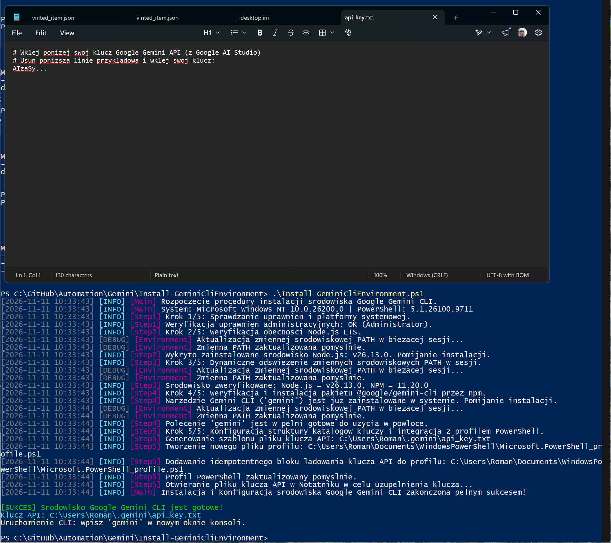
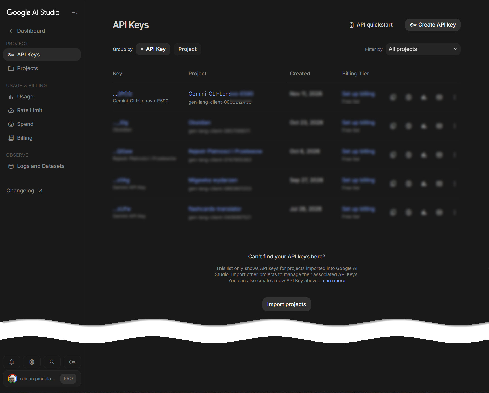
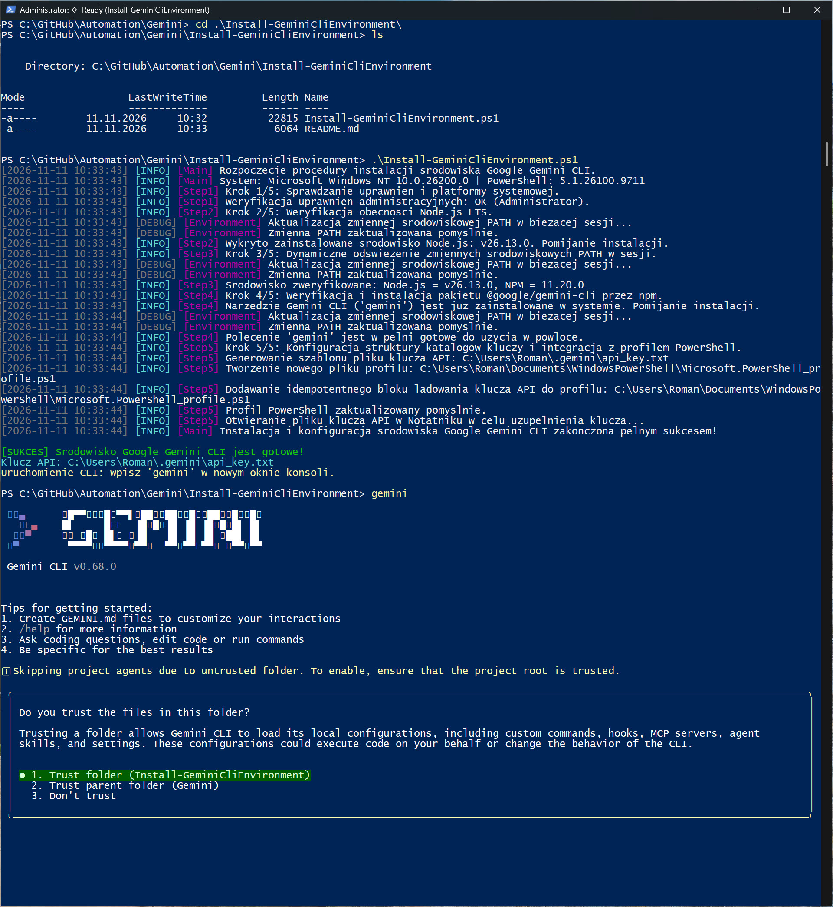
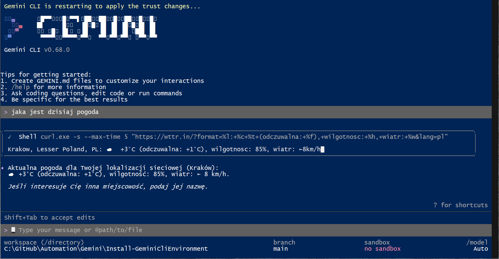
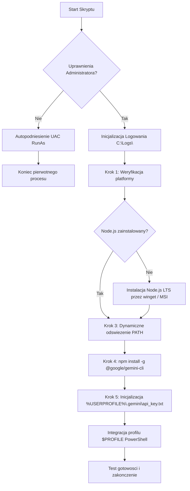

# Install-GeminiCliEnvironment

[](https://microsoft.com/powershell)
[](https://nodejs.org/)
[](https://www.npmjs.com/package/@google/gemini-cli)
[](https://opensource.org/licenses/MIT)

Kompleksowy skrypt automatyzacji PowerShell przygotowujący środowisko uruchomieniowe dla narzędzia **Google Gemini CLI** (`@google/gemini-cli`) w systemie Windows.

---

## 1. Informacje Ogólne

- **Katalog projektu:** `C:\GitHub\Automation\Gemini\Install-GeminiCliEnvironment`
- **Główny plik skryptu:** `Install-GeminiCliEnvironment.ps1`
- **Autor:** Rafał Pindela / Automatyzacja PowerShell
- **Kompatybilność:** Windows PowerShell 5.1 oraz PowerShell 7+ (`dual-compatibility`)

---

## 2. Zrzuty Ekranu i Przebieg Wdrożenia

### 2.1. Standardowe wykonanie skryptu instalacyjnego
Automatyczna weryfikacja środowiska, uprawnień UAC, instalacja Node.js LTS, odświeżenie PATH, instalacja pakietu `@google/gemini-cli` oraz konfiguracja profilu:



### 2.2. Panel Google AI Studio i pobranie klucza API
Uzyskanie klucza Google Gemini API w konsoli Google AI Studio:



### 2.3. Inicjalizacja Gemini CLI w PowerShell
Pierwsze uruchomienie polecenia `gemini` w nowym oknie konsoli:



### 2.4. Interaktywna praca z agentem Gemini w terminalu
Praca w trybie konwersacyjnym i wykonywanie poleceń przez Google Gemini CLI:



---

## 3. Cel i Architektura Rozwiązania

Skrypt automatyzuje cały proces konfiguracji stacji roboczej lub serwera pod kątem korzystania z oficjalnego wiersza poleceń Gemini:
1. **Weryfikacja środowiska i elewacja uprawnień (UAC):** Skrypt automatycznie sprawdza uprawnienia administracyjne; w przypadku ich braku podnosi proces do roli Administratora zachowując wszystkie przekazane parametry.
2. **Instalacja Node.js LTS:** Sprawdza dostępność środowiska uruchomieniowego. W razie braku instaluje najnowszą wersję LTS za pomocą menedżera pakietów `winget` (`OpenJS.NodeJS.LTS`), z inteligentnym fallbackiem na cichy instalator MSI pobierany bezpośrednio z serwerów Node.js.
3. **Dynamiczne odświeżenie PATH:** Natychmiast uaktualnia zmienną środowiskową `$env:PATH` w bieżącej sesji konsoli, zapobiegając konieczności restartu terminala.
4. **Instalacja Gemini CLI:** Globalna instalacja narzędzia za pośrednictwem `npm install -g @google/gemini-cli`.
5. **Bezpieczny magazyn klucza API i integracja z profilem:**
   - Tworzy katalog `%USERPROFILE%\.gemini` oraz plik konfiguracyjny `api_key.txt`.
   - Dopisuje idempotentny blok ładowania do profilu PowerShell (`$PROFILE`), dzięki czemu zmienna `$env:GEMINI_API_KEY` jest automatycznie dostępna przy każdym otwarciu konsoli.

---

## 4. Schemat Działania



---

## 5. Wymagania Wstępne

- System operacyjny: **Windows 10 / 11** lub **Windows Server 2016+** (architektura 64-bitowa).
- Powłoka: **Windows PowerShell 5.1** lub **PowerShell 7.x+**.
- Dostęp do Internetu (pobranie Node.js oraz pakietów npm).
- Uprawnienia lokalnego administratora (skrypt automatycznie wywołuje monit UAC).

---

## 6. Parametry Wejściowe

| Parametr | Typ | Domyślnie | Opis |
| :--- | :--- | :--- | :--- |
| `-ForceReinstall` | `[switch]` | `$false` | Wymusza ponowną instalację pakietów Node.js oraz Gemini CLI, nawet jeśli istnieją. |
| `-ApiKey` | `[string]` | `$null` | Opcjonalny klucz Google Gemini API; jeśli podany, zapisuje go od razu do pliku `api_key.txt`. |
| `-LogDirectory` | `[string]` | `'C:\Logs'` | Katalog docelowy zapisu plików dziennika zdarzeń. |
| `-Quiet` | `[switch]` | `$false` | Tryb cichy – blokuje automatyczne otwarcie edytora Notatnik po zakończeniu. |

---

## 7. Przykłady Użycia

### 7.1. Standardowe uruchomienie
```powershell
.\Install-GeminiCliEnvironment.ps1
```
Sprawdza środowisko, instaluje brakujące komponenty, tworzy szablon klucza i otwiera plik w Notatniku.

### 7.2. Ciche wdrożenie z gotowym kluczem API
```powershell
.\Install-GeminiCliEnvironment.ps1 -ApiKey "AIzaSyD-TwojKluczGemini..." -Quiet
```
Idealne do skryptów automatyzacji wdrożeń – instaluje wszystko w tle i konfiguruje klucz bez interakcji z użytkownikiem.

### 7.3. Wymuszenie reinstalacji z niestandardowym katalogiem logów
```powershell
.\Install-GeminiCliEnvironment.ps1 -ForceReinstall -LogDirectory "D:\Dzienniki"
```

---

## 8. Zarządzanie Kluczem API

Klucz API przechowywany jest w chronionym katalogu profilu użytkownika:
- **Ścieżka:** `%USERPROFILE%\.gemini\api_key.txt`
- **Format pliku:**
  ```text
  # Google Gemini API Key
  AIzaSy...twoj_klucz_api...
  ```

### Automatyczne ładowanie w profilu (`$PROFILE`)
Skrypt dodaje do pliku `$PROFILE` bezpieczny znacznik:
```powershell
# >>> GEMINI-CLI-INIT >>>
$geminiKeyFile = "$env:USERPROFILE\.gemini\api_key.txt"
if (Test-Path -Path $geminiKeyFile) {
    $rawKey = (Get-Content -Path $geminiKeyFile | Where-Object { $_ -notmatch '^\s*#' -and $_.Trim() -ne '' } | Select-Object -First 1)
    if ($rawKey) {
        $env:GEMINI_API_KEY = $rawKey.Trim()
    }
}
# <<< GEMINI-CLI-INIT <<<
```
Zapewnia to, że zmienna `$env:GEMINI_API_KEY` jest zawsze automatycznie dostępna przy uruchomieniu terminala bez konieczności ręcznego eksportu.

---

## 9. Logowanie i Diagnostyka

- Domyślny plik logu: `C:\Logs\Install-GeminiCliEnvironment_YYYY-MM-DD.log`.
- Każdy wpis zawiera znacznik czasu, poziom (`[INFO]`, `[WARN]`, `[ERROR]`, `[DEBUG]`) oraz nazwę komponentu.
- Logi są równolegle prezentowane w oknie konsoli z czytelnym formatowaniem kolorystycznym.

### Kody Wyjścia (`Exit Codes`)

| Kod | Status | Opis |
| :---: | :--- | :--- |
| `0` | **Sukces** | Środowisko Node.js, Gemini CLI oraz pliki konfiguracyjne zostały pomyślnie wdrożone. |
| `1` | **Błąd środowiskowy** | Błąd pobierania, instalacji silnika Node.js lub błąd instalacji npm. |
| `2` | **Błąd uprawnień / profilu** | Błąd autopodniesienia UAC lub brak uprawnień do zapisu pliku profilu PowerShell. |

---

## 10. Rozpoczęcie Pracy z Gemini CLI

Po zakończeniu działania skryptu otwórz nowe okno PowerShell / Windows Terminal i wpisz:

```powershell
gemini
```

Możesz natychmiast zadawać pytania, analizować kod, zarządzać zadaniami lub korzystać z wbudowanych narzędzi Gemini wprost z wiersza poleceń.
