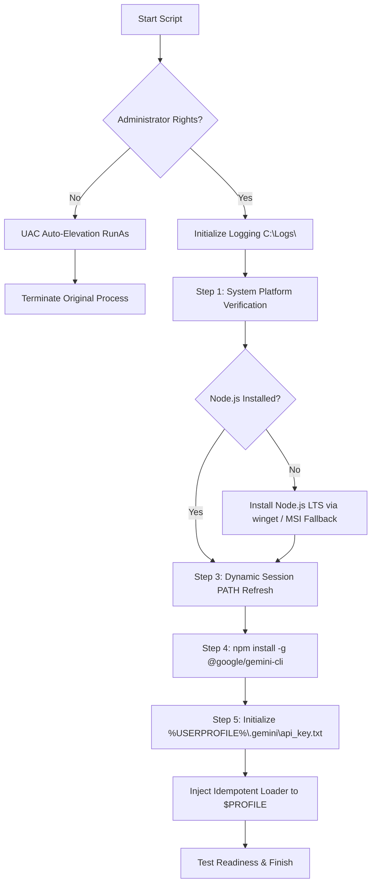

# Install-GeminiCliEnvironment

[](https://microsoft.com/powershell)
[](https://nodejs.org/)
[](https://www.npmjs.com/package/@google/gemini-cli)
[](https://opensource.org/licenses/MIT)

An enterprise-grade, clean-code PowerShell automation script that provisions a complete runtime and execution environment for the official **Google Gemini CLI** (`@google/gemini-cli`) on Windows.

---

## 1. Project Information

| Parameter | Value |
| :--- | :--- |
| **Project Directory** | `C:\GitHub\Automation\Gemini\Install-GeminiCliEnvironment` |
| **Script Name** | `Install-GeminiCliEnvironment.ps1` |
| **Author** | Rafal Pindela / PowerShell Automation |
| **Compatibility** | Windows PowerShell 5.1 & PowerShell 7+ (`dual-compatibility`) |
| **Package Reference** | [`@google/gemini-cli` (npm)](https://www.npmjs.com/package/@google/gemini-cli) |

---

## 2. Visual Walkthrough & Screenshots

### 2.1. Automated Pipeline Execution
Automatic privilege checks, UAC elevation, Node.js LTS verification and installation, in-flight PATH refresh, `@google/gemini-cli` global deployment, and profile credential injection:


### 2.2. Google AI Studio API Key Provisioning
Generating and retrieving the Google Gemini API key from the Google AI Studio console:


### 2.3. Initializing Gemini CLI in PowerShell
First launch of the `gemini` command in a fresh PowerShell terminal:


### 2.4. Interactive Agent Session
Conversational interaction, command execution, and code generation with Google Gemini CLI:


---

## 3. Architecture & Core Features

`Install-GeminiCliEnvironment.ps1` automates the entire setup lifecycle:

1. **UAC Auto-Elevation:** Automatically checks for local administrator privileges. If unprivileged, it restarts itself in an elevated session (`RunAs`), preserving all initial invocation switches and parameters.
2. **Node.js LTS Runtime Provisioning:** Detects existing installations. If missing or forced (`-ForceReinstall`), it installs the latest LTS release via the Windows Package Manager (`winget install --id OpenJS.NodeJS.LTS`), falling back gracefully to direct silent MSI installation (`msiexec /i ... /qn /norestart`).
3. **Dynamic Session PATH Refresh:** Reconstructs and injects `Machine` and `User` PATH variables in-memory along with default Node/NPM bin directories, eliminating the need to restart the shell to access newly installed commands.
4. **Global Gemini CLI Deployment:** Deploys `@google/gemini-cli` globally via `npm install -g @google/gemini-cli`.
5. **Secure Credential Store & `$PROFILE` Integration:**
   - Prepares a dedicated, protected directory: `%USERPROFILE%\.gemini\`
   - Generates the configuration template `api_key.txt` (or injects the `-ApiKey` argument directly).
   - Injects an idempotent loader block into the PowerShell profile (`$PROFILE`), automatically setting `$env:GEMINI_API_KEY` whenever a new terminal session starts.

---

## 4. Execution Workflow



---

## 5. Prerequisites

- **Operating System:** Windows 10 / 11 or Windows Server 2016+ (64-bit architecture).
- **PowerShell:** Windows PowerShell 5.1 or PowerShell Core 7.x+.
- **Network:** Active internet connection (for package and installer downloads).
- **Privileges:** Local Administrator rights (triggers UAC automatically if unprivileged).

---

## 6. Parameters Reference

| Parameter | Type | Default | Description |
| :--- | :--- | :--- | :--- |
| `-ForceReinstall` | `[switch]` | `$false` | Forces reinstallation of Node.js and the Gemini CLI package even if already detected. |
| `-ApiKey` | `[string]` | `$null` | Optional Google Gemini API key. If supplied, written immediately to `api_key.txt`. |
| `-LogDirectory` | `[string]` | `'C:\Logs'` | Destination directory for timestamped execution logs. |
| `-Quiet` | `[switch]` | `$false` | Suppresses automatic launch of Notepad with the key template file upon completion. |

---

## 7. Practical Examples

### 7.1. Standard Interactive Execution
```powershell
.\Install-GeminiCliEnvironment.ps1
```
Runs environment checks, installs missing dependencies, creates the API key template, and opens it in Notepad.

### 7.2. Silent Automated Deployment with Pre-Supplied API Key
```powershell
.\Install-GeminiCliEnvironment.ps1 -ApiKey "AIzaSyD-YourSecretApiKey..." -Quiet
```
Ideal for unattended setup scripts—configures the runtime, sets the key, and completes without interactive prompts.

### 7.3. Forced Reinstallation with Custom Log Path
```powershell
.\Install-GeminiCliEnvironment.ps1 -ForceReinstall -LogDirectory "D:\SetupLogs"
```

---

## 8. API Key Management

The API key is securely isolated within the user's profile directory:
- **Location:** `%USERPROFILE%\.gemini\api_key.txt`
- **File Structure:**
  ```text
  # Google Gemini API Key
  AIzaSy...your_gemini_api_key...
  ```

### Automatic Profile Injection (`$PROFILE`)
The script adds an idempotent initialization block to `$PROFILE`:

```powershell
# >>> GEMINI-CLI-INIT >>>
$geminiKeyFile = "$env:USERPROFILE\.gemini\api_key.txt"
if (Test-Path -Path $geminiKeyFile) {
    $rawKey = (Get-Content -Path $geminiKeyFile | Where-Object { $_ -notmatch '^\s*#' -and $_.Trim() -ne '' } | Select-Object -First 1)
    if ($rawKey) {
        $env:GEMINI_API_KEY = $rawKey.Trim()
    }
}
# <<< GEMINI-CLI-INIT <<<
```
This guarantees that `$env:GEMINI_API_KEY` is loaded every time PowerShell starts.

---

## 9. Logging & Diagnostics

- **Log File Location:** `C:\Logs\Install-GeminiCliEnvironment_YYYY-MM-DD.log`
- **Format:** `[YYYY-MM-DD HH:mm:ss] [LEVEL] [Component] Message`
- Real-time colorized console feedback is rendered alongside persistent disk logs.

### Exit Codes

| Code | Status | Description |
| :---: | :--- | :--- |
| `0` | **Success** | Environment, dependencies, and configuration deployed cleanly. |
| `1` | **Environment Error** | Download failure, package installation failure, or missing platform requirements. |
| `2` | **Permission / Profile Error** | UAC elevation denied or failure writing to `$PROFILE`. |

---

## 10. Getting Started with Gemini CLI

Once the setup script finishes, launch a new PowerShell or Windows Terminal tab and type:

```powershell
gemini
```

You can now ask questions, refactor code, run agentic workflows, and interact with Google Gemini models directly from your command line.
