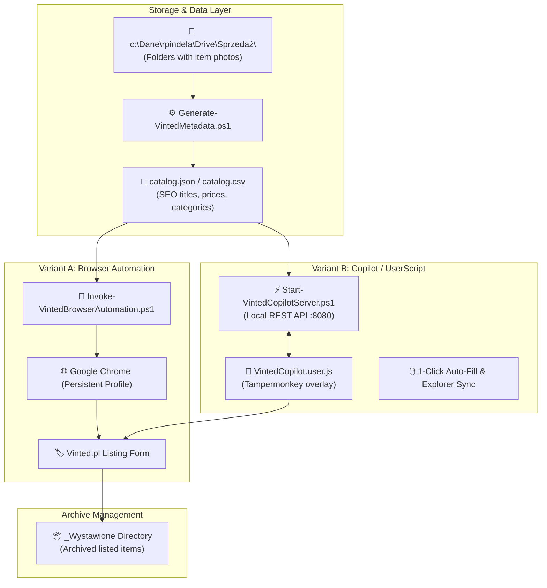

# Vinted Sales Automation Suite

A modular, anti-bot safe automation framework designed to streamline and accelerate the process of listing products on Vinted.

---

## Author & Project Info

- **Author**: Roman Pindela
- **Email**: [roman.pindela@gmail.com](mailto:roman.pindela@gmail.com)
- **GitHub**: [https://github.com/romanpindela](https://github.com/romanpindela)
- **Version**: 1.0.0
- **License**: MIT

---

## Technical Architecture & How It Works



---

## Key Features

1. **AI / Rule-Based Metadata Generator (`Generate-VintedMetadata.ps1`)**:
   - Automatically scans item directories in `c:\Dane\rpindela\Drive\Sprzedaż\`.
   - Infers brands (Adidas, Medhoodie, Hama, CAT, etc.), clothing sizes (34/XS, 38/M, children's ages/heights), colors, package tiers, and competitive pricing.
   - Generates attractive, SEO-optimized Polish titles and selling descriptions with bullet points.
   - Outputs both individual `vinted_item.json` files and unified `catalog.json` & `catalog.csv` (ready for Excel editing).

2. **Variant A: Persistent Browser Runner (`Invoke-VintedBrowserAutomation.ps1`)**:
   - Launches an authentic Google Chrome instance with an isolated, persistent user profile directory (`c:\Dane\rpindela\VintedChromeProfile`).
   - Keeps your Vinted login session and 2FA cookies active.
   - Zero risk of Cloudflare or DataDome bot detection bans.
   - Guides you step-by-step with 1-click clipboard population and folder opening.

3. **Variant B: Vinted Copilot UserScript & Local Companion API (`VintedCopilot.user.js` + `Start-VintedCopilotServer.ps1`)**:
   - **Local REST API**: Runs a native, zero-dependency .NET HTTP listener in PowerShell serving endpoints on `http://127.0.0.1:8080`.
   - **Floating Copilot Widget**: Injected right into `https://www.vinted.pl/items/new`.
   - **1-Click Auto-Fill**: Injects Title, Description, Price, Condition, and copies Brand & Size directly into React form state.
   - **Explorer Quick-Launch**: Opens the exact photo folder on your Windows desktop so you can drag-and-drop photos into Vinted in 2 seconds.
   - **Archive Sync**: Clicking *Wystawione* automatically moves the folder to `_Wystawione` and loads the next item.

---

## Directory Structure

```text
C:\Dane\rpindela\GitHub\Automation\Vinted-Automation\
├── Generate-VintedMetadata.ps1       # Generates catalog.json and metadata
├── Start-VintedCopilotServer.ps1     # Variant B: Local companion HTTP server
├── VintedCopilot.user.js             # Variant B: Tampermonkey userscript
├── Invoke-VintedBrowserAutomation.ps1# Variant A: Assisted browser runner
├── catalog.json                      # Consolidated metadata for all items
├── catalog.csv                       # Spreadsheet-ready catalog for Excel
└── README.md                         # Documentation
```

---

## Prerequisites

1. **Operating System**: Windows 10 / Windows 11 / Windows Server
2. **PowerShell**: Windows PowerShell 5.1 or PowerShell Core 7+
3. **Browser**: Google Chrome
4. **Extensions (for Variant B)**: [Tampermonkey](https://www.tampermonkey.net/) installed in your Chrome browser.

> [!NOTE]
> If scripts are downloaded from a remote git repository, ensure you unblock them:
> ```powershell
> Unblock-File -Path .\*.ps1
> ```

---

## Quick Start Guide

### Step 1: Generate or Update Item Metadata

Run the metadata generator against your items folder:

```powershell
.\Generate-VintedMetadata.ps1 -SourcePath "c:\Dane\rpindela\Drive\Sprzedaż"
```

*Optionally review and adjust prices in `catalog.csv` in Excel.*

---

### Step 2: Choose Your Execution Variant

#### Option 1: Variant B (Copilot UserScript - Recommended for maximum comfort)

1. Open PowerShell and start the local companion server:
   ```powershell
   .\Start-VintedCopilotServer.ps1
   ```
2. In Chrome, install [Tampermonkey](https://www.tampermonkey.net/) and create a new script by pasting the contents of `VintedCopilot.user.js`.
3. Navigate to [https://www.vinted.pl/items/new](https://www.vinted.pl/items/new).
4. The **🛍️ Vinted Copilot** panel will appear in the bottom-right corner:
   - Select an item from the dropdown list.
   - Click **📂 Otwórz folder ze zdjęciami** and drag-and-drop photos onto the Vinted page.
   - Click **⚡ 1-Click: Wypełnij dane na Vinted** to populate titles, prices, descriptions, and attributes.
   - Click **Wystaw** on Vinted.
   - Click **✅ Oznacz jako wystawione** to archive the folder and automatically move to the next item!

#### Option 2: Variant A (Console Guided Browser Runner)

1. Run the browser automation script:
   ```powershell
   .\Invoke-VintedBrowserAutomation.ps1
   ```
2. Chrome will launch automatically with your dedicated profile.
3. Log in to Vinted once (if not already logged in).
4. The console prompt will walk you through each item:
   - `[O]` Opens photos folder and copies listing text to clipboard.
   - `[W]` Archives item to `_Wystawione`.
   - `[S]` Skips to next item.

---

## Logging & Auditing

All scripts support enterprise-grade logging. To enable file-based execution logging to `C:\Logs\`:

```powershell
.\Generate-VintedMetadata.ps1 -EnableLogging
.\Start-VintedCopilotServer.ps1 -EnableLogging
.\Invoke-VintedBrowserAutomation.ps1 -EnableLogging
```

Logs are generated with standard timestamped format:
`C:\Logs\<YYYYMMDD-HHmmss>-<ScriptName>-<ComputerName>-<Username>.log`

---

## Suggested Git Commit

```text
feat(vinted-automation): implement dual-variant Vinted listing automation suite

- Added Generate-VintedMetadata.ps1 to parse item folders and produce structured catalog.json/csv.
- Added Start-VintedCopilotServer.ps1 with native .NET HttpListener for folder and listing management.
- Implemented VintedCopilot.user.js Tampermonkey overlay for 1-click form population on vinted.pl.
- Implemented Invoke-VintedBrowserAutomation.ps1 for persistent profile Chrome orchestration.
- Added comprehensive README documentation with Mermaid architecture diagrams.
```
