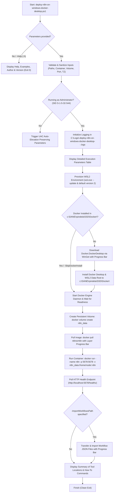

# Deploy Self-Hosted n8n with Docker (`deploy-n8n-on-windows-docker-desktop`)

[](https://microsoft.com/powershell)
[](https://www.docker.com/products/docker-desktop/)
[](https://docs.n8n.io/deploy/host-n8n/install-options/install-with-docker)
[](https://opensource.org/licenses/MIT)

An enterprise-grade, Clean Code PowerShell automation script that downloads and installs **Docker Desktop** via **WinGet** to a custom SSD directory (`c:\DANE\rpindela\SSD\Docker\`) and provisions a self-hosted **n8n** workflow automation platform in Docker following the official n8n Docker installation specification.

---

## 📋 Project Information

| Parameter | Value |
| :--- | :--- |
| **Project Name** | Deploy Self-Hosted n8n with Docker (`deploy-n8n-on-windows-docker-desktop`) |
| **Script Name** | `deploy-n8n-on-windows-docker-desktop.ps1` |
| **Author** | Roman Pindela |
| **Email** | [roman.pindela@gmail.com](mailto:roman.pindela@gmail.com) |
| **GitHub** | [https://github.com/romanpindela](https://github.com/romanpindela) |
| **Version** | 1.2.0 |
| **Release Date** | 2026-10-16 |
| **License** | MIT |
| **Official n8n Reference** | [Install n8n with Docker](https://docs.n8n.io/deploy/host-n8n/install-options/install-with-docker) |

---

## 🚀 Overview & Key Features

Self-hosting **n8n** on Windows workstations or servers typically requires installing Docker Desktop, relocating large WSL2 virtual disks away from the system drive, creating persistent Docker volumes, configuring timezone and security environment variables, and managing container updates.

`deploy-n8n-on-windows-docker-desktop.ps1` automates the entire lifecycle from zero to a ready-to-use n8n instance:

* **Zero-Parameter Interactive Help (`-Help` / `-h`):** Launching the script without arguments or with `-h` displays a comprehensive help guide, parameter reference, version, author info, and practical examples without triggering an unnecessary UAC prompt.
* **WSL2 Environment Provisioning (`wsl.exe --update`):** Verifies and enables required Windows Subsystem for Linux (`Microsoft-Windows-Subsystem-Linux`) and `VirtualMachinePlatform` features, runs `wsl.exe --update` with a real-time progress bar, and sets WSL 2 as the default architecture (`wsl.exe --set-default-version 2`).
* **Custom SSD Installation via WinGet:** Downloads `Docker.DockerDesktop` via Windows Package Manager (`winget`) and installs binaries, WSL2 distribution storage (`wsl`), and Windows container storage (`windows-containers`) directly into `c:\DANE\rpindela\SSD\Docker\` (configurable via `-DockerInstallDir`).
* **Official n8n Docker Configuration:** Provisions the persistent `n8n_data` Docker volume (`docker volume create n8n_data`) and launches `n8nio/n8n` with port mapping (`5678:5678`), `GENERIC_TIMEZONE`, `TZ`, and `N8N_ENFORCE_SETTINGS_FILE_PERMISSIONS=true`.
* **SQLite & PostgreSQL Support:** Runs out-of-the-box with persistent SQLite storage in `/home/node/.n8n`, or connects to an external PostgreSQL database when `-UsePostgres` is supplied.
* **Real-Time Multi-Stage Progress Bars (`Write-Progress`):**
  * Tracks WSL2 environment update (`wsl.exe --update`) and feature verification.
  * Tracks WinGet installer download progress (MB transferred, total MB, transfer speed in MB/s, percentage).
  * Tracks Docker Engine initialization and `docker pull n8nio/n8n` image layer downloads/extractions (`[done/total]` layers).
  * Tracks per-file transfer and CLI import progress (`-ImportWorkflowsPath`) when uploading local `.json` workflows into the container.
* **Post-Deployment Tool Locations & Quick-Start Summary:** Immediately after installation (or via `-Status`), displays a structured summary of where every binary, volume, and log is located, along with essential commands to operate WSL2, Docker, and n8n.
* **Language-Independent UAC Auto-Elevation:** Validates administrative privileges using the well-known Windows SID (`S-1-5-32-544` / `BuiltInAdministratorsSid`), ensuring 100% compatibility on both Polish (`Administratorzy`) and English (`Administrators`) editions of Windows.
* **Detailed Execution Logging:** Automatically records timestamped UTF-8 logs to `C:\Logs\<yyyyMMdd_HHmmss>-deploy-n8n-on-windows-docker-desktop-<ComputerName>-<UserName>.logs`.

---

## 📂 Directory Structure

```text
deploy-n8n-on-windows-docker-desktop/
├── assets/
│   └── .gitkeep                    # Directory for execution screenshots
├── deploy-n8n-on-windows-docker-desktop.ps1                  # Main PowerShell deployment & lifecycle script
└── README.md                       # Technical documentation & usage guide
```

Target SSD installation layout created by the script:

```text
c:\DANE\rpindela\SSD\Docker\
├── Docker Desktop.exe              # Docker Desktop GUI application
├── resources\
│   └── bin\
│       ├── docker.exe              # Docker CLI binary
│       └── docker-compose.exe      # Docker Compose v2 CLI binary
├── wsl\                            # WSL2 virtual disk data root (--wsl-default-data-root)
├── windows-containers\             # Windows containers data root
└── installer\                      # Downloaded Docker Desktop Installer cache
```

---

## 💻 System Requirements

* **Operating System:** Windows 10 (64-bit, build 19045+) / Windows 11 (64-bit) / Windows Server 2022+.
* **Hardware Virtualization:** WSL 2 and BIOS/UEFI hardware virtualization (Intel VT-x / AMD-V) enabled.
* **Package Manager:** Windows Package Manager (`winget`) v1.4+.
* **Privileges:** Administrator privileges required for Docker Desktop installation and service registration (the script automatically requests UAC elevation when needed).

---

## 📥 Getting Started

### 1. Unblock the Script (Required After Downloading from GitHub)

When downloading PowerShell scripts from GitHub or the internet, Windows attaches a `Zone.Identifier` alternate data stream. Unblock the script before running it:

```powershell
Unblock-File -Path .\deploy-n8n-on-windows-docker-desktop.ps1
```

Ensure the PowerShell execution policy allows running local scripts:

```powershell
Set-ExecutionPolicy -ExecutionPolicy RemoteSigned -Scope CurrentUser
```

### 2. Display Help & Usage Examples

Run the script without parameters or pass `-h` / `-Help`:

```powershell
.\deploy-n8n-on-windows-docker-desktop.ps1
# or
.\deploy-n8n-on-windows-docker-desktop.ps1 -h
```

---

## 📖 Parameter Reference

| Parameter | Aliases | Type | Default | Description |
| :--- | :--- | :--- | :--- | :--- |
| `-Deploy` | `-Install`, `-Run`, `-Start`, `-d` | `[switch]` | `$false` | Executes the full deployment pipeline (`wsl.exe --update` + Docker Desktop install + n8n container startup). |
| `-DockerInstallDir` | `-InstallDir`, `-DockerPath`, `-Path` | `[string]` | `c:\DANE\rpindela\SSD\Docker\` | Target directory on disk for Docker Desktop binaries, WSL2 data root, and installer cache. |
| `-ContainerName` | `-Name`, `-Container` | `[string]` | `n8n` | Name of the n8n Docker container. |
| `-DataVolumeName` | `-Volume`, `-VolumeName` | `[string]` | `n8n_data` | Name of the persistent Docker volume mounted to `/home/node/.n8n`. |
| `-Port` | `-p`, `-HostPort` | `[int]` | `5678` | Host TCP port mapped to container port `5678`. |
| `-Timezone` | `-tz` | `[string]` | `Europe/Warsaw` | IANA timezone assigned to `GENERIC_TIMEZONE` and `TZ`. |
| `-ImageTag` | `-Tag`, `-Version` | `[string]` | `latest` | Image tag for `n8nio/n8n` (`latest`, `stable`, `next`, or specific version e.g. `2.43.7`). |
| `-Interactive` | | `[switch]` | `$false` | Runs container in foreground interactive mode (`-it --rm`) instead of detached daemon mode (`-d --restart unless-stopped`). |
| `-SkipWslUpdate` | | `[switch]` | `$false` | Skips running `wsl.exe --update` and WSL2 default version setup during deployment. |
| `-SkipDockerInstall` | | `[switch]` | `$false` | Skips WinGet Docker Desktop installation check and deploys the n8n container directly. |
| `-ImportWorkflowsPath`| `-WorkflowsPath`, `-UploadPath`, `-SyncPath` | `[string]` | `$null` | Local `.json` file or folder of workflows to transfer into the container and import via n8n CLI with a detailed progress bar. |
| `-UsePostgres` | | `[switch]` | `$false` | Configures n8n to use PostgreSQL instead of SQLite via `DB_POSTGRESDB_*` environment variables. |
| `-PostgresHost` | | `[string]` | `localhost` | PostgreSQL server hostname or IP address. |
| `-PostgresPort` | | `[int]` | `5432` | PostgreSQL server TCP port. |
| `-PostgresDatabase` | | `[string]` | `n8n` | PostgreSQL database name. |
| `-PostgresUser` | | `[string]` | `postgres` | PostgreSQL username. |
| `-PostgresPassword` | | `[string]` | `$null` | PostgreSQL password. |
| `-PostgresSchema` | | `[string]` | `public` | PostgreSQL schema name. |
| `-Update` | `-u`, `-Upgrade` | `[switch]` | `$false` | Pulls the latest/specified `n8nio/n8n` image and recreates the container while preserving `n8n_data`. |
| `-Status` | `-s`, `-Info` | `[switch]` | `$false` | Displays current WSL2/Docker/n8n status, tool paths, and usage cheat sheet. |
| `-OpenBrowser` | | `[switch]` | `$false` | Automatically opens `http://localhost:<Port>` in the default browser once deployment completes. |
| `-LogPath` | `-l`, `-Log` | `[string]` | `C:\Logs\...` | Custom path for the execution log file. |
| `-Help` | `-h` | `[switch]` | `$false` | Displays the built-in help guide and exits. |

---

## 💡 Practical Usage Examples

### Example 1: Display Interactive Help & Author Info
```powershell
.\deploy-n8n-on-windows-docker-desktop.ps1
```

### Example 2: Standard Full Deployment to `c:\DANE\rpindela\SSD\Docker\`
Updates WSL2 (`wsl.exe --update`), downloads and installs Docker Desktop via WinGet into `c:\DANE\rpindela\SSD\Docker\`, starts the Docker Engine daemon, creates the `n8n_data` persistent volume, pulls `n8nio/n8n:latest`, starts the `n8n` container on port `5678`, and outputs the tool locations summary:
```powershell
.\deploy-n8n-on-windows-docker-desktop.ps1 -Deploy
```

### Example 3: Deploy with Custom Port, Timezone, and Auto-Launch Browser
```powershell
.\deploy-n8n-on-windows-docker-desktop.ps1 -Deploy -DockerInstallDir "c:\DANE\rpindela\SSD\Docker\" -Port 5678 -Timezone "Europe/Warsaw" -OpenBrowser
```

### Example 4: Deploy n8n and Upload Local Workflow JSON Files with Progress Bar
Uploads all `.json` workflow files from a local folder into the container (`docker cp`) and imports them via `n8n import:workflow`, displaying a per-file transfer progress bar:
```powershell
.\deploy-n8n-on-windows-docker-desktop.ps1 -Deploy -ImportWorkflowsPath "C:\Automation\n8n-workflows"
```

### Example 5: Deploy n8n with External PostgreSQL Database
Configures n8n with PostgreSQL environment variables as documented in the official n8n Docker guide:
```powershell
.\deploy-n8n-on-windows-docker-desktop.ps1 -Deploy `
    -UsePostgres `
    -PostgresHost "10.10.1.50" `
    -PostgresPort 5432 `
    -PostgresDatabase "n8n_prod" `
    -PostgresUser "n8n_admin" `
    -PostgresPassword "StrongPassword123!" `
    -PostgresSchema "public"
```

### Example 6: Update Existing n8n Container to Latest Release
Pulls the newest `n8nio/n8n` image, stops and removes the old container, and starts a fresh container attached to the existing `n8n_data` volume:
```powershell
.\deploy-n8n-on-windows-docker-desktop.ps1 -Update -ImageTag "latest"
```

### Example 7: Inspect Tool Locations & Quick-Start Commands (`-Status`)
```powershell
.\deploy-n8n-on-windows-docker-desktop.ps1 -Status
```

---

## 🖥️ Sample Console Output

```text
================================================================================
  deploy-n8n-on-windows-docker-desktop v1.2.0 - Detailed Execution Parameters
  Author: Roman Pindela | Contact: roman.pindela@gmail.com
================================================================================
    Operation Mode            : Full Deployment (WSL2 Update + WinGet Docker Desktop + n8n Container)
    WSL2 Environment Setup    : Enabled (wsl.exe --update & default version 2)
    Docker Install Directory  : c:\DANE\rpindela\SSD\Docker
    WSL2 Data Root Path       : c:\DANE\rpindela\SSD\Docker\wsl
    Win Containers Data Root  : c:\DANE\rpindela\SSD\Docker\windows-containers
    Installer Staging Folder  : c:\DANE\rpindela\SSD\Docker\installer
    n8n Docker Image          : n8nio/n8n:latest
    n8n Container Name        : n8n
    n8n Persistent Volume     : n8n_data -> /home/node/.n8n
    n8n Host Port Mapping     : http://localhost:5678 -> 5678/tcp
    n8n Timezone (TZ)         : Europe/Warsaw
    n8n File Permissions Enf. : N8N_ENFORCE_SETTINGS_FILE_PERMISSIONS=true
    n8n Database Backend      : SQLite (Default in /home/node/.n8n)
    Container Run Mode        : Detached Daemon (-d --restart unless-stopped)
    Active Log File           : C:\Logs\20261016_191500-deploy-n8n-on-windows-docker-desktop-WORKSTATION-Roman.logs
================================================================================
[>] Checking and provisioning WSL2 environment for Docker & n8n (C:\Windows\System32\wsl.exe)...
[>] Executing 'wsl.exe --update' to install/update the WSL2 Linux kernel...
[+] Successfully updated WSL2 environment ('wsl.exe --update' exit code: 0).
[+] Configured WSL 2 as the default WSL architecture.
[>] Preparing Docker directories in 'c:\DANE\rpindela\SSD\Docker'...
[+] Docker Engine daemon is active and ready.
[>] Creating persistent Docker volume 'n8n_data' (docker volume create n8n_data)...
[+] Docker volume 'n8n_data' is ready.
[>] Pulling Docker image 'n8nio/n8n:latest' from registry...
[+] Successfully pulled Docker image 'n8nio/n8n:latest'.
[>] Starting n8n container: docker run -d --restart unless-stopped --name n8n -p 5678:5678 ...
[+] n8n Web Editor is online and healthy at http://localhost:5678

================================================================================
  DEPLOYMENT SUMMARY: TOOL LOCATIONS & QUICK-START GUIDE
================================================================================
  [1] WHERE ALL TOOLS & DATA ARE LOCATED:
      * WSL2 Executable (wsl.exe): C:\Windows\System32\wsl.exe
      * Docker Root Directory    : c:\DANE\rpindela\SSD\Docker
      * Docker Desktop GUI App   : c:\DANE\rpindela\SSD\Docker\Docker Desktop.exe
      * Docker CLI Executable    : c:\DANE\rpindela\SSD\Docker\resources\bin\docker.exe
      * Docker Compose CLI       : c:\DANE\rpindela\SSD\Docker\resources\bin\docker-compose.exe
      * WSL2 Disk Data Root      : c:\DANE\rpindela\SSD\Docker\wsl
      * Windows Containers Root  : c:\DANE\rpindela\SSD\Docker\windows-containers
      * Installer Cache Folder   : c:\DANE\rpindela\SSD\Docker\installer
      * n8n Persistent Volume    : n8n_data -> /home/node/.n8n
      * Execution Log File       : C:\Logs\20261016_191500-deploy-n8n-on-windows-docker-desktop-WORKSTATION-Roman.logs

  [2] N8N INSTANCE STATUS & ACCESS:
      * Container Name           : n8n
      * Container Status         : Up (n8nio/n8n:latest)
      * n8n Web Editor URL       : http://localhost:5678
      * n8n Healthcheck URL      : http://localhost:5678/healthz

  [3] HOW TO USE WSL2, DOCKER & N8N (ESSENTIAL COMMANDS):
      * Open n8n in Browser      : Start-Process "http://localhost:5678"
      * Update WSL2 Environment  : wsl.exe --update
      * Check WSL2 Distributions : wsl.exe --list --verbose
      * Check Running Containers : docker ps
      * View Live n8n Logs       : docker logs -f n8n
      * Stop / Start / Restart   : docker stop n8n | docker start n8n | docker restart n8n
      * Open Shell in n8n        : docker exec -it n8n /bin/sh
      * Backup n8n Data Locally  : docker cp n8n:/home/node/.n8n .\n8n_backup
      * Update n8n via Script    : .\deploy-n8n-on-windows-docker-desktop.ps1 -Update
================================================================================
```

---

## 🔄 Deployment Architecture & Workflow



---

## 📜 Version History

* **v1.2.0 (2026-10-16):**
  * Implemented automatic UAC elevation prompt and language-independent Administrator verification using well-known SID (`BuiltInAdministratorsSid`).
  * Added automated WSL2 environment provisioning (`wsl.exe --update`, `wsl.exe --set-default-version 2`, and DISM WSL2 feature verification).
  * Added custom-directory WinGet download and installation for Docker Desktop (`c:\DANE\rpindela\SSD\Docker\`) including WSL2 and Windows containers data roots.
  * Added official n8n Docker container provisioning (`n8n_data` volume, timezone configuration, `N8N_ENFORCE_SETTINGS_FILE_PERMISSIONS=true`, optional PostgreSQL backend).
  * Added multi-stage `Write-Progress` bars for WSL2 update, installer download, Docker Engine startup, image layer pulling, and workflow file transfers (`-ImportWorkflowsPath`).
  * Added comprehensive timestamped logging to `C:\Logs\<DateTime>-deploy-n8n-on-windows-docker-desktop-<ComputerName>-<UserName>.logs` and post-install tool locations summary.

---

## 👤 Author & Contact

* **Author:** Roman Pindela
* **Email:** [roman.pindela@gmail.com](mailto:roman.pindela@gmail.com)
* **GitHub:** [https://github.com/romanpindela](https://github.com/romanpindela)
* **License:** MIT
