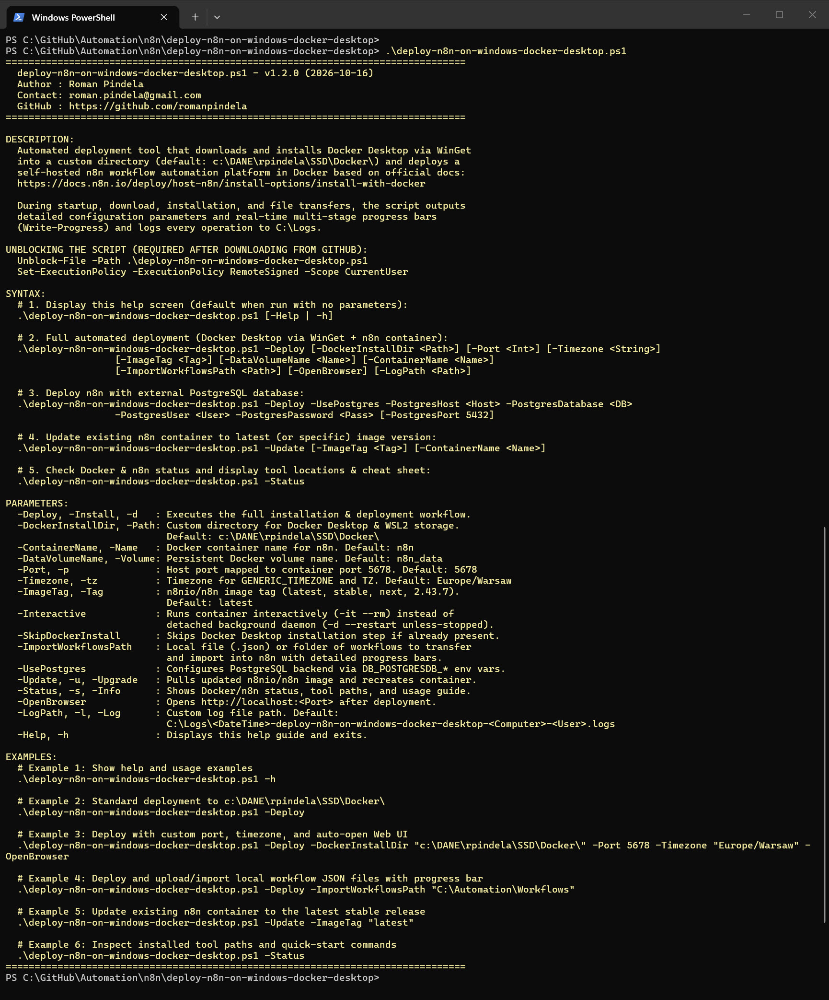
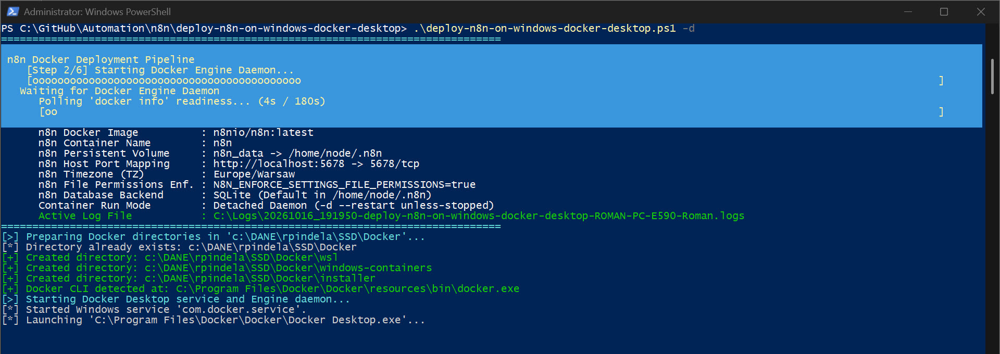
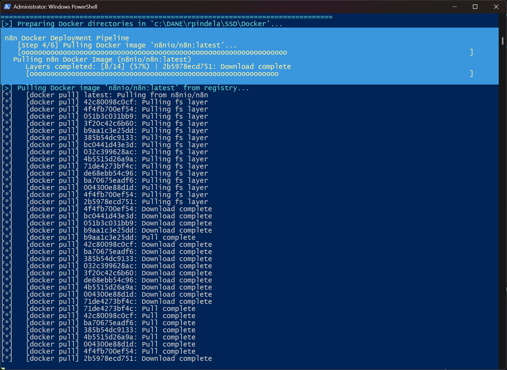
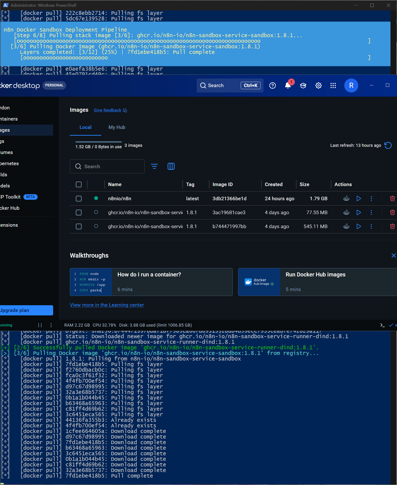
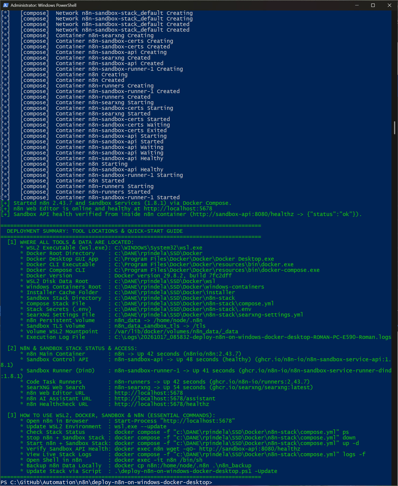
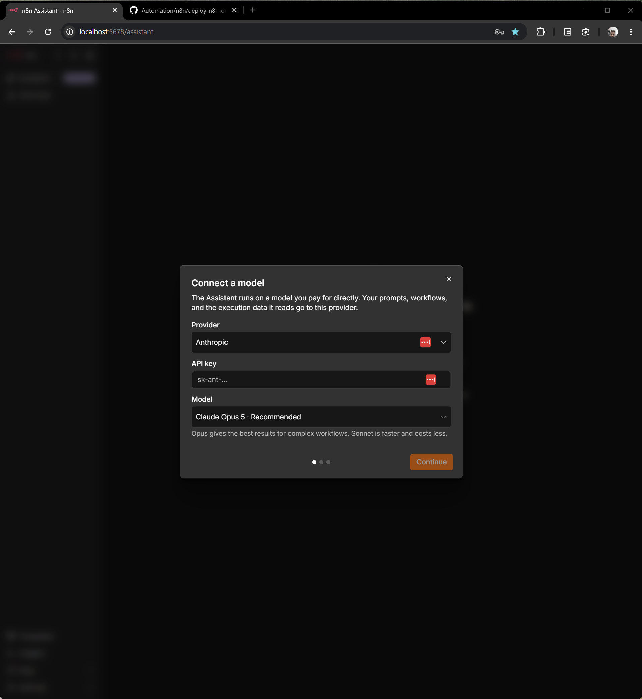
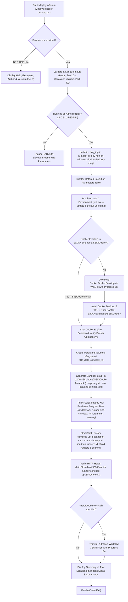

# Deploy Self-Hosted n8n with Docker & AI Sandbox (`deploy-n8n-on-windows-docker-desktop`)

[](https://microsoft.com/powershell)
[](https://www.docker.com/products/docker-desktop/)
[](https://docs.n8n.io/deploy/host-n8n/install-options/install-using-docker-compose)
[](https://opensource.org/licenses/MIT)

An enterprise-grade, Clean Code PowerShell automation script that provisions **WSL2** (`wsl.exe --update`), downloads and installs **Docker Desktop** via **WinGet** to a custom SSD directory (`c:\DANE\rpindela\SSD\Docker\`), and deploys a self-hosted **n8n** workflow automation platform in Docker with the complete official **n8n AI Assistant Sandbox Stack** (`sandbox-certs`, `sandbox-api`, `sandbox-runner-1`, `runners`, `searxng`).

---

## 📋 Project Information

| Parameter | Value |
| :--- | :--- |
| **Project Name** | Deploy Self-Hosted n8n with Docker & Sandbox (`deploy-n8n-on-windows-docker-desktop`) |
| **Script Name** | `deploy-n8n-on-windows-docker-desktop.ps1` |
| **Author** | Roman Pindela |
| **Email** | [roman.pindela@gmail.com](mailto:roman.pindela@gmail.com) |
| **GitHub** | [https://github.com/romanpindela](https://github.com/romanpindela) |
| **Version** | 1.3.0 |
| **Release Date** | 2026-10-17 |
| **License** | MIT |
| **Official n8n References** | [Install using Docker Compose & Sandbox](https://docs.n8n.io/deploy/host-n8n/install-options/install-using-docker-compose) · [One-Line Setup (`get.n8n.io`)](https://get.n8n.io) · [Install with Docker](https://docs.n8n.io/deploy/host-n8n/install-options/install-with-docker) |

---

## 🚀 Overview & Key Features

Modern self-hosted **n8n** instances—including the built-in **n8n AI Assistant** (`http://localhost:5678/assistant`) and isolated **Code Nodes**—require a multi-container **Sandbox & Task Runner stack** so AI-generated code and JavaScript/Python scripts execute inside ephemeral, isolated containers rather than inside the main n8n process.

`deploy-n8n-on-windows-docker-desktop.ps1` automates the entire lifecycle on Windows from zero to a production-ready local n8n + Sandbox environment:

* **Zero-Parameter Interactive Help (`-Help` / `-h`):** Launching the script without arguments or with `-h` displays a comprehensive help guide, parameter reference, version, author info, and practical examples without triggering an unnecessary UAC prompt.
* **WSL2 Environment Provisioning (`wsl.exe --update`):** Verifies and enables required Windows Subsystem for Linux (`Microsoft-Windows-Subsystem-Linux`) and `VirtualMachinePlatform` features, runs `wsl.exe --update` with a real-time progress bar, and sets WSL 2 as the default architecture (`wsl.exe --set-default-version 2`).
* **Custom SSD Installation via WinGet:** Downloads `Docker.DockerDesktop` via Windows Package Manager (`winget`) and installs binaries, WSL2 distribution storage (`wsl`), and Windows container storage (`windows-containers`) directly into `c:\DANE\rpindela\SSD\Docker\` (configurable via `-DockerInstallDir`).
* **Full Official n8n + AI Assistant Sandbox Stack (Docker Compose v2):** Generates `compose.yml`, `.env` (with cryptographically generated 48-hex-character mTLS and API secrets), and `searxng-settings.yml` in `c:\DANE\rpindela\SSD\Docker\n8n-stack\`, provisioning all 6 official stack services:
  1. **`sandbox-certs`** (`ghcr.io/n8n-io/n8n-sandbox-service-api`): Bootstrap init container that generates mutual TLS (mTLS) certificates into the `${DataVolumeName}_sandbox_tls` volume and exits cleanly.
  2. **`sandbox-api`** (`ghcr.io/n8n-io/n8n-sandbox-service-api`): Control-plane gRPC/HTTP API for the n8n AI Assistant Sandbox (`http://sandbox-api:8080/healthz`).
  3. **`sandbox-runner-1`** (`ghcr.io/n8n-io/n8n-sandbox-service-runner-dind`): Privileged Docker-in-Docker (DinD) worker that spins up ephemeral `ghcr.io/n8n-io/n8n-sandbox-service-sandbox` micro-containers per code execution request.
  4. **`n8n`** (`docker.io/n8nio/n8n`): Main workflow editor on `http://localhost:5678`, attached to the persistent `n8n_data` volume (`/home/node/.n8n`), with `GENERIC_TIMEZONE`, `TZ`, `N8N_ENFORCE_SETTINGS_FILE_PERMISSIONS=true`, and pre-wired Sandbox & SearXNG environment variables.
  5. **`runners`** (`ghcr.io/n8n-io/runners`): External Task Runners sidecar isolating JavaScript and Python Code node execution (`N8N_RUNNERS_MODE=external`).
  6. **`searxng`** (`ghcr.io/searxng/searxng:latest`): Bundled SearXNG meta-search service enabling web search for the n8n AI Assistant.
* **SQLite & PostgreSQL Support:** Runs out-of-the-box with persistent SQLite storage in `/home/node/.n8n`, or connects to an external PostgreSQL database when `-UsePostgres` is supplied.
* **Real-Time Multi-Stage Progress Bars (`Write-Progress`):**
  * Tracks WSL2 environment update (`wsl.exe --update`) and feature verification.
  * Tracks WinGet installer download progress (MB transferred, total MB, transfer speed in MB/s, percentage).
  * Tracks Docker Engine initialization and layer-by-layer pulls (`[done/total]` layers) across all 6 Sandbox & n8n images.
  * Tracks per-file transfer and CLI import progress (`-ImportWorkflowsPath`) when uploading local `.json` workflows into the container.
* **Post-Deployment Tool Locations & Quick-Start Summary:** Immediately after installation (or via `-Status`), displays a structured summary of where every binary, Compose stack file, volume, and log is located, along with live statuses for all Sandbox containers and essential commands.
* **Language-Independent UAC Auto-Elevation:** Validates administrative privileges using the well-known Windows SID (`S-1-5-32-544` / `BuiltInAdministratorsSid`), ensuring 100% compatibility on both Polish (`Administratorzy`) and English (`Administrators`) editions of Windows.
* **Detailed Execution Logging:** Automatically records timestamped UTF-8 logs to `C:\Logs\<yyyyMMdd_HHmmss>-deploy-n8n-on-windows-docker-desktop-<ComputerName>-<UserName>.logs`.

---

## 📂 Directory Structure

```text
deploy-n8n-on-windows-docker-desktop/
├── assets/
│   ├── .gitkeep
│   ├── Standard_run.jpg                      # Screenshot: Interactive help & zero-parameter run
│   ├── deploying_docker.jpg                  # Screenshot: Docker Engine startup & directory preparation
│   ├── deploying_docker2.jpg                 # Screenshot: Real-time n8nio/n8n image layer download progress
│   ├── sandbox_for_n8n.jpg                   # Screenshot: Pulling n8n Sandbox stack images & Docker Desktop view
│   ├── deployment_summary.jpg                # Screenshot: Full 6-service Sandbox stack startup & summary
│   ├── Configuring_AI_Assistant_for_n8n.jpg  # Screenshot: Configuring n8n AI Assistant model at localhost:5678
│   └── launching_n8n_on_localmachine.jpg     # Screenshot: Launching n8n Web UI & AI Assistant on localhost
├── deploy-n8n-on-windows-docker-desktop.ps1  # Main PowerShell deployment & lifecycle script
└── README.md                                 # Technical documentation & usage guide
```

Target SSD installation layout created by the script:

```text
c:\DANE\rpindela\SSD\Docker\
├── Docker Desktop.exe              # Docker Desktop GUI application
├── resources\
│   └── bin\
│       ├── docker.exe              # Docker CLI binary
│       └── docker-compose.exe      # Docker Compose v2 CLI binary
├── n8n-stack\                      # Official n8n + AI Assistant Sandbox Compose stack
│   ├── compose.yml                 # 6-service Docker Compose stack definition
│   ├── .env                        # Auto-generated cryptographic secrets & configuration
│   └── searxng-settings.yml        # SearXNG JSON API configuration for n8n Assistant
├── wsl\                            # WSL2 virtual disk data root (--wsl-default-data-root)
├── windows-containers\             # Windows containers data root
└── installer\                      # Downloaded Docker Desktop Installer cache
```

---

## 💻 System Requirements

* **Operating System:** Windows 10 (64-bit, build 19045+) / Windows 11 (64-bit) / Windows Server 2022+.
* **Hardware Virtualization & Resources:** WSL 2 and BIOS/UEFI hardware virtualization (Intel VT-x / AMD-V) enabled; at least **4 GB RAM** and **2 vCPUs** allocated to Docker Desktop (required for the privileged Docker-in-Docker `sandbox-runner-1` service).
* **Package Manager:** Windows Package Manager (`winget`) v1.4+.
* **Privileges:** Administrator privileges required for Docker Desktop installation and service registration (the script automatically requests UAC elevation when needed).

---

## 📥 Getting Started

### 1. Unblock the Script (Required After Downloading from GitHub)

When downloading PowerShell scripts from GitHub or the internet, Windows attaches a `Zone.Identifier` alternate data stream. Unblock the script before running it:

```powershell
Unblock-File -Path .\deploy-n8n-on-windows-docker-desktop.ps1
```

Ensure the PowerShell execution policy allows running local scripts:

```powershell
Set-ExecutionPolicy -ExecutionPolicy RemoteSigned -Scope CurrentUser
```

### 2. Display Help & Usage Examples

Run the script without parameters or pass `-h` / `-Help`:

```powershell
.\deploy-n8n-on-windows-docker-desktop.ps1
# or
.\deploy-n8n-on-windows-docker-desktop.ps1 -h
```

---

## 📖 Parameter Reference

| Parameter | Aliases | Type | Default | Description |
| :--- | :--- | :--- | :--- | :--- |
| `-Deploy` | `-Install`, `-Run`, `-Start`, `-d` | `[switch]` | `$false` | Executes the full deployment pipeline (`wsl.exe --update` + Docker Desktop install + n8n Docker Compose Sandbox stack). |
| `-DockerInstallDir` | `-InstallDir`, `-DockerPath`, `-Path` | `[string]` | `c:\DANE\rpindela\SSD\Docker\` | Target directory on disk for Docker Desktop binaries, WSL2 data root, and installer cache. |
| `-StackDir` | | `[string]` | `c:\DANE\rpindela\SSD\Docker\n8n-stack` | Target directory where `compose.yml`, `.env`, and `searxng-settings.yml` are generated. |
| `-ContainerName` | `-Name`, `-Container` | `[string]` | `n8n` | Name prefix for the n8n container and Sandbox services (`n8n`, `n8n-sandbox-api`, `n8n-sandbox-runner-1`, `n8n-runners`, `n8n-searxng`). |
| `-DataVolumeName` | `-Volume`, `-VolumeName` | `[string]` | `n8n_data` | Name of the persistent Docker volume mounted to `/home/node/.n8n` (and `${DataVolumeName}_sandbox_tls` for mTLS certs). |
| `-Port` | `-p`, `-HostPort` | `[int]` | `5678` | Host TCP port mapped to n8n container port `5678`. |
| `-Timezone` | `-tz` | `[string]` | `Europe/Warsaw` | IANA timezone assigned to `GENERIC_TIMEZONE` and `TZ`. |
| `-ImageTag` | `-Tag`, `-Version` | `[string]` | `latest` | Version tag for `n8nio/n8n` and `ghcr.io/n8n-io/runners` (`latest` automatically resolves the latest stable GitHub release, e.g., `2.43.7`). |
| `-SandboxVersion` | | `[string]` | `1.8.1` | Version tag for `ghcr.io/n8n-io/n8n-sandbox-service-*` images (`api`, `runner-dind`, `sandbox`). |
| `-SkipSandbox` | | `[switch]` | `$false` | Deploys standalone single-container `n8nio/n8n` (`docker run`) without the Docker Compose Sandbox stack. |
| `-Interactive` | | `[switch]` | `$false` | Runs standalone container in foreground interactive mode (`-it --rm`) when combined with `-SkipSandbox`. |
| `-SkipWslUpdate` | | `[switch]` | `$false` | Skips running `wsl.exe --update` and WSL2 default version setup during deployment. |
| `-SkipDockerInstall` | | `[switch]` | `$false` | Skips WinGet Docker Desktop installation check and deploys the n8n stack directly. |
| `-ImportWorkflowsPath`| `-WorkflowsPath`, `-UploadPath`, `-SyncPath` | `[string]` | `$null` | Local `.json` file or folder of workflows to transfer into the container and import via n8n CLI with a detailed progress bar. |
| `-UsePostgres` | | `[switch]` | `$false` | Configures n8n to use PostgreSQL instead of SQLite via `DB_POSTGRESDB_*` environment variables. |
| `-PostgresHost` | | `[string]` | `localhost` | PostgreSQL server hostname or IP address. |
| `-PostgresPort` | | `[int]` | `5432` | PostgreSQL server TCP port. |
| `-PostgresDatabase` | | `[string]` | `n8n` | PostgreSQL database name. |
| `-PostgresUser` | | `[string]` | `postgres` | PostgreSQL username. |
| `-PostgresPassword` | | `[string]` | `$null` | PostgreSQL password. |
| `-PostgresSchema` | | `[string]` | `public` | PostgreSQL schema name. |
| `-Update` | `-u`, `-Upgrade` | `[switch]` | `$false` | Pulls the latest/specified `n8nio/n8n` and Sandbox images and recreates the stack while preserving `n8n_data` and `.env` secrets. |
| `-Status` | `-s`, `-Info` | `[switch]` | `$false` | Displays current WSL2/Docker/n8n Sandbox stack status, tool paths, and usage cheat sheet. |
| `-OpenBrowser` | | `[switch]` | `$false` | Automatically opens `http://localhost:<Port>` in the default browser once deployment completes. |
| `-LogPath` | `-l`, `-Log` | `[string]` | `C:\Logs\...` | Custom path for the execution log file. |
| `-Help` | `-h` | `[switch]` | `$false` | Displays the built-in help guide and exits. |

---

## 💡 Practical Usage Examples

### Example 1: Display Interactive Help & Author Info
```powershell
.\deploy-n8n-on-windows-docker-desktop.ps1
```

### Example 2: Standard Full Deployment with Sandbox Stack to `c:\DANE\rpindela\SSD\Docker\`
Updates WSL2 (`wsl.exe --update`), installs Docker Desktop via WinGet into `c:\DANE\rpindela\SSD\Docker\`, starts the Docker Engine daemon, generates `compose.yml`, `.env`, and `searxng-settings.yml` in `c:\DANE\rpindela\SSD\Docker\n8n-stack`, pulls all 6 n8n & Sandbox images with layer progress bars, starts the stack on port `5678`, verifies both `sandbox-api` and `n8n` health endpoints, and outputs the tool locations summary:
```powershell
.\deploy-n8n-on-windows-docker-desktop.ps1 -Deploy
```

### Example 3: Deploy with Custom Port, Timezone, and Auto-Launch Browser
```powershell
.\deploy-n8n-on-windows-docker-desktop.ps1 -Deploy -DockerInstallDir "c:\DANE\rpindela\SSD\Docker\" -Port 5678 -Timezone "Europe/Warsaw" -OpenBrowser
```

### Example 4: Deploy n8n + Sandbox and Upload Local Workflow JSON Files with Progress Bar
Uploads all `.json` workflow files from a local folder into the container (`docker cp`) and imports them via `n8n import:workflow`, displaying a per-file transfer progress bar:
```powershell
.\deploy-n8n-on-windows-docker-desktop.ps1 -Deploy -ImportWorkflowsPath "C:\Automation\n8n-workflows"
```

### Example 5: Deploy n8n + Sandbox with External PostgreSQL Database
Configures n8n with PostgreSQL environment variables in `.env`:
```powershell
.\deploy-n8n-on-windows-docker-desktop.ps1 -Deploy `
    -UsePostgres `
    -PostgresHost "10.10.1.50" `
    -PostgresPort 5432 `
    -PostgresDatabase "n8n_prod" `
    -PostgresUser "n8n_admin" `
    -PostgresPassword "StrongPassword123!" `
    -PostgresSchema "public"
```

### Example 6: Update Existing n8n + Sandbox Stack to Latest Release
Resolves the newest stable `n8nio/n8n` release, pulls updated images, and recreates the Compose stack while preserving the `n8n_data` volume and existing `.env` secrets:
```powershell
.\deploy-n8n-on-windows-docker-desktop.ps1 -Update
```

### Example 7: Inspect Tool Locations, Sandbox Containers & Quick-Start Commands (`-Status`)
```powershell
.\deploy-n8n-on-windows-docker-desktop.ps1 -Status
```

---

## 📸 Screenshots & Visual Verification

### 1. Interactive Zero-Parameter Help & Usage Guide (`Standard_run.jpg`)
Running `.\deploy-n8n-on-windows-docker-desktop.ps1` without parameters (or with `-h`) displays the full help screen, version, author info, parameter list, and practical examples:



### 2. Detailed Startup Parameters & Docker Engine Readiness (`deploying_docker.jpg`)
Launching the deployment (`-d` / `-Deploy`) displays the detailed execution parameter table, creates the target SSD directory structure (`c:\DANE\rpindela\SSD\Docker`), and tracks Docker Engine daemon initialization with a real-time `Write-Progress` bar:



### 3. Real-Time n8n Image Pull & Layer Progress Bar (`deploying_docker2.jpg`)
While pulling the main `n8nio/n8n` image, the script parses layer-by-layer download and extraction events and renders a live `Write-Progress` bar (`Layers completed: [8/14] (57%)`):



### 4. Pulling n8n Sandbox Stack Images & Docker Desktop Inspection (`sandbox_for_n8n.jpg`)
Multi-stage `Write-Progress` bar tracking all 6 Sandbox stack images (`[3/6] Pulling Docker Image ghcr.io/n8n-io/n8n-sandbox-service-sandbox:1.8.1`) alongside the Docker Desktop GUI showing the downloaded `n8n-sandbox-service` images:



### 5. Full 6-Service Sandbox Stack Orchestration & Deployment Summary (`deployment_summary.jpg`)
Complete Docker Compose Sandbox stack startup (`n8n-sandbox-certs`, `n8n-sandbox-api` Healthy, `n8n-sandbox-runner-1`, `n8n`, `n8n-runners`, `n8n-searxng`), internal health verification (`http://sandbox-api:8080/healthz -> {"status":"ok"}`), and the post-deployment tool locations & quick-start guide:



### 6. Configuring n8n AI Assistant with Sandbox Support (`Configuring_AI_Assistant_for_n8n.jpg`)
Connecting an AI model provider (e.g., Anthropic Claude Opus 5) in the n8n AI Assistant (`http://localhost:5678/assistant`), backed by the local Docker Sandbox stack:



### 7. Launching Self-Hosted n8n Web UI on Localhost (`launching_n8n_on_localmachine.jpg`)
Accessing the deployed self-hosted n8n instance in the browser at `http://localhost:5678`:


---

## 🖥️ Sample Console Output

```text
================================================================================
  deploy-n8n-on-windows-docker-desktop v1.3.0 - Detailed Execution Parameters
  Author: Roman Pindela | Contact: roman.pindela@gmail.com
================================================================================
    Operation Mode            : Full Sandbox Deployment (WSL2 + Docker Desktop + n8n Docker Compose Sandbox Stack)
    WSL2 Environment Setup    : Enabled (wsl.exe --update & default version 2)
    Docker Install Directory  : c:\DANE\rpindela\SSD\Docker
    WSL2 Data Root Path       : c:\DANE\rpindela\SSD\Docker\wsl
    Win Containers Data Root  : c:\DANE\rpindela\SSD\Docker\windows-containers
    Installer Staging Folder  : c:\DANE\rpindela\SSD\Docker\installer
    n8n Sandbox Architecture  : Enabled (Docker Compose: n8n + sandbox-certs + sandbox-api + sandbox-runner-1 + runners + searxng)
    Sandbox Stack Directory   : c:\DANE\rpindela\SSD\Docker\n8n-stack
    Sandbox Service Version   : ghcr.io/n8n-io/n8n-sandbox-service-*:1.8.1
    n8n Image Tag / Version   : n8nio/n8n:latest
    n8n Container Name        : n8n
    n8n Persistent Volume     : n8n_data -> /home/node/.n8n
    n8n Host Port Mapping     : http://localhost:5678 -> 5678/tcp
    n8n Timezone (TZ)         : Europe/Warsaw
    n8n File Permissions Enf. : N8N_ENFORCE_SETTINGS_FILE_PERMISSIONS=true
    n8n Database Backend      : SQLite (Default in /home/node/.n8n)
    Container Run Mode        : Docker Compose v2 Stack (docker compose up -d)
    Active Log File           : C:\Logs\20261017_085000-deploy-n8n-on-windows-docker-desktop-WORKSTATION-Roman.logs
================================================================================
[>] Checking and provisioning WSL2 environment for Docker & n8n (C:\Windows\System32\wsl.exe)...
[+] Successfully updated WSL2 environment ('wsl.exe --update' exit code: 0).
[+] Configured WSL 2 as the default WSL architecture.
[+] Docker Engine daemon is active and ready.
[+] Docker Compose v2 verified: Docker Compose version v5.6.0
[>] Generating n8n Sandbox stack configuration files in 'c:\DANE\rpindela\SSD\Docker\n8n-stack'...
[+] Created SearXNG configuration: c:\DANE\rpindela\SSD\Docker\n8n-stack\searxng-settings.yml
[+] Created/updated environment secrets file: c:\DANE\rpindela\SSD\Docker\n8n-stack\.env
[+] Created Docker Compose Sandbox stack file: c:\DANE\rpindela\SSD\Docker\n8n-stack\compose.yml
[+] Started n8n 2.43.7 and Sandbox Services (1.8.1) via Docker Compose.
[+] n8n Web Editor is online and healthy at http://localhost:5678
[+] Sandbox API health verified from inside n8n container (http://sandbox-api:8080/healthz -> {"status":"ok"}).

================================================================================
  DEPLOYMENT SUMMARY: TOOL LOCATIONS & QUICK-START GUIDE
================================================================================
  [1] WHERE ALL TOOLS & DATA ARE LOCATED:
      * WSL2 Executable (wsl.exe): C:\Windows\System32\wsl.exe
      * Docker Root Directory    : c:\DANE\rpindela\SSD\Docker
      * Docker Desktop GUI App   : c:\DANE\rpindela\SSD\Docker\Docker Desktop.exe
      * Docker CLI Executable    : c:\DANE\rpindela\SSD\Docker\resources\bin\docker.exe
      * Docker Compose CLI       : c:\DANE\rpindela\SSD\Docker\resources\bin\docker-compose.exe
      * WSL2 Disk Data Root      : c:\DANE\rpindela\SSD\Docker\wsl
      * Windows Containers Root  : c:\DANE\rpindela\SSD\Docker\windows-containers
      * Installer Cache Folder   : c:\DANE\rpindela\SSD\Docker\installer
      * Sandbox Stack Directory  : c:\DANE\rpindela\SSD\Docker\n8n-stack
      * Compose Stack File       : c:\DANE\rpindela\SSD\Docker\n8n-stack\compose.yml
      * Stack Secrets (.env)     : c:\DANE\rpindela\SSD\Docker\n8n-stack\.env
      * SearXNG Settings File    : c:\DANE\rpindela\SSD\Docker\n8n-stack\searxng-settings.yml
      * n8n Persistent Volume    : n8n_data -> /home/node/.n8n
      * Sandbox TLS Volume       : n8n_data_sandbox_tls -> /tls
      * Execution Log File       : C:\Logs\20261017_085000-deploy-n8n-on-windows-docker-desktop-WORKSTATION-Roman.logs

  [2] N8N & SANDBOX STACK STATUS & ACCESS:
      * n8n Main Container       : n8n -> Up (docker.io/n8nio/n8n:2.43.7)
      * Sandbox Control API      : n8n-sandbox-api -> Up (healthy) (ghcr.io/n8n-io/n8n-sandbox-service-api:1.8.1)
      * Sandbox Runner (DinD)    : n8n-sandbox-runner-1 -> Up (ghcr.io/n8n-io/n8n-sandbox-service-runner-dind:1.8.1)
      * Code Task Runners        : n8n-runners -> Up (ghcr.io/n8n-io/runners:2.43.7)
      * SearXNG Web Search       : n8n-searxng -> Up (ghcr.io/searxng/searxng:latest)
      * n8n Web Editor URL       : http://localhost:5678
      * n8n AI Assistant URL     : http://localhost:5678/assistant
      * n8n Healthcheck URL      : http://localhost:5678/healthz

  [3] HOW TO USE WSL2, DOCKER, SANDBOX & N8N (ESSENTIAL COMMANDS):
      * Open n8n in Browser      : Start-Process "http://localhost:5678"
      * Update WSL2 Environment  : wsl.exe --update
      * Check Stack Status       : docker compose -f "c:\DANE\rpindela\SSD\Docker\n8n-stack\compose.yml" ps
      * Stop n8n + Sandbox Stack : docker compose -f "c:\DANE\rpindela\SSD\Docker\n8n-stack\compose.yml" down
      * Start n8n + Sandbox Stack: docker compose -f "c:\DANE\rpindela\SSD\Docker\n8n-stack\compose.yml" up -d
      * Verify Sandbox API Health: docker exec n8n wget -qO- http://sandbox-api:8080/healthz
      * View Live Stack Logs     : docker compose -f "c:\DANE\rpindela\SSD\Docker\n8n-stack\compose.yml" logs -f
      * Open Shell in n8n        : docker exec -it n8n /bin/sh
      * Backup n8n Data Locally  : docker cp n8n:/home/node/.n8n .\n8n_backup
      * Update Stack via Script  : .\deploy-n8n-on-windows-docker-desktop.ps1 -Update
================================================================================
```

---

## 🔄 Deployment Architecture & Sandbox Workflow



---

## 📜 Version History

* **v1.3.0 (2026-10-17):**
  * Added full official **n8n + AI Assistant Sandbox Stack** deployment via Docker Compose v2 (`https://get.n8n.io` / `get-n8n-compose.yml`).
  * Automated generation of `compose.yml`, `.env` (with cryptographically random 48-hex-character mTLS/API secrets via `RandomNumberGenerator`), and `searxng-settings.yml` in `c:\DANE\rpindela\SSD\Docker\n8n-stack\`.
  * Added provisioning and health verification for all 6 stack services: `sandbox-certs`, `sandbox-api`, `sandbox-runner-1` (Docker-in-Docker), `n8n`, `runners` (External Task Runners), and `searxng`.
  * Added automatic migration from standalone `n8n` containers to the Docker Compose Sandbox stack while preserving existing data in the `n8n_data` volume.
* **v1.2.0 (2026-10-16):**
  * Implemented automatic UAC elevation prompt and language-independent Administrator verification using well-known SID (`BuiltInAdministratorsSid`).
  * Added automated WSL2 environment provisioning (`wsl.exe --update`, `wsl.exe --set-default-version 2`, and DISM WSL2 feature verification).
  * Added custom-directory WinGet download and installation for Docker Desktop (`c:\DANE\rpindela\SSD\Docker\`) including WSL2 and Windows containers data roots.
  * Added multi-stage `Write-Progress` bars for WSL2 update, installer download, Docker Engine startup, image layer pulling, and workflow file transfers (`-ImportWorkflowsPath`).
  * Added comprehensive timestamped logging to `C:\Logs\<DateTime>-deploy-n8n-on-windows-docker-desktop-<ComputerName>-<UserName>.logs` and post-install tool locations summary.

---

## 👤 Author & Contact

* **Author:** Roman Pindela
* **Email:** [roman.pindela@gmail.com](mailto:roman.pindela@gmail.com)
* **GitHub:** [https://github.com/romanpindela](https://github.com/romanpindela)
* **License:** MIT
